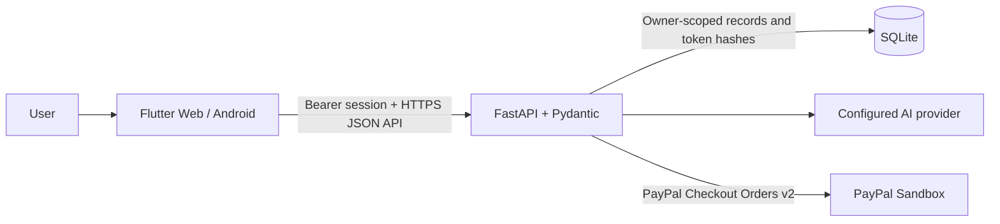

# Architecture

AlvaPay is a Flutter client backed by a Python API. Integrations are built
incrementally; payment status is only persisted after server-side verification.

The Flutter client is untrusted and contains no provider credentials. The
backend owns AI parsing, validation, persistence, order creation, capture, and
payment verification. Anonymous session tokens are returned once and stored
only as hashes; invoice reads and mutations are scoped to their session owner.
Invoice creation, order creation, and capture use stable idempotency keys.
Creating checkout is gated by explicit user confirmation. Payment status moves
to paid only after the backend verifies the completed PayPal order and exact
amount/currency.
