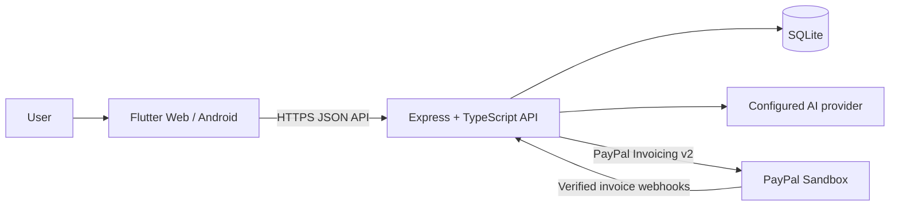

# Architecture

Initial milestone scaffold; integrations and persistence will be added in later
milestones.

The Flutter client is untrusted and contains no provider credentials. The
backend owns parsing, validation, persistence, invoice creation, status
tracking, reminders, and chat tools. Invoice creation is gated by an explicit
user confirmation.
